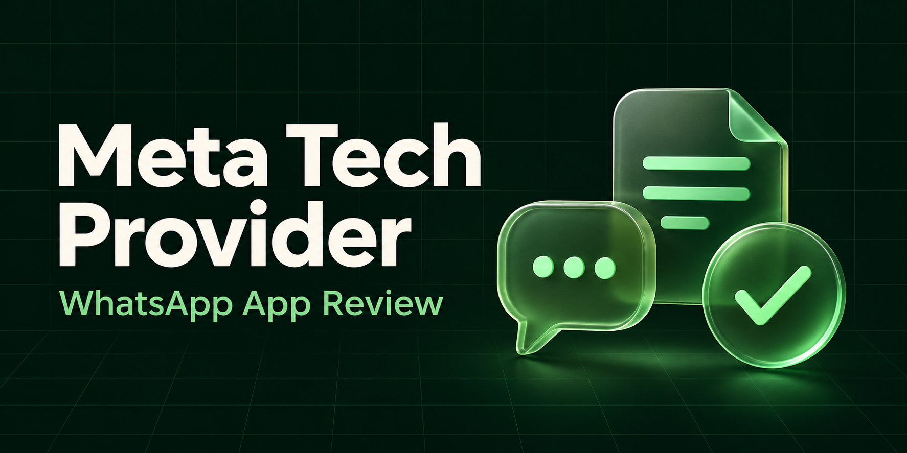

# Meta Tech Provider for WhatsApp



**Get your WhatsApp integration ready for Meta App Review with Codex.**

If you build a SaaS, CRM, or support tool that serves other businesses' WhatsApp accounts, your reviewer needs to open the product and reproduce each permission you request. This skill gives Codex a workflow to find what's missing, test the integration, and prepare evidence a reviewer can follow.

[Install the skill](#install) · [See what you get](#what-you-get) · [Read the approval case](#an-18-day-app-review-case)

## What you get

- **A plan for your product.** Start with a prototype or an existing integration. Codex identifies the Meta accounts, business verification steps, and test setup your project needs.
- **A demo a reviewer can use.** Prepare a test login where needed, a working WhatsApp test account, and exact steps with expected results.
- **Evidence for each permission.** Record a real message arriving in WhatsApp and a real template created in the test account. Attach each recording to the matching permission.
- **A submission you can check.** Reopen the saved draft, play both videos, and confirm the required fields. After submission, follow the same request until the dashboard shows a decision.

Codex does the work it has access to. It brings you in for business decisions, missing facts, and confirmations Meta requires from the account holder.

## Install

Paste this into Codex to install the skill.

```text
$skill-installer https://github.com/Sinapta-Solutions/meta-tech-provider/tree/main/meta-tech-provider
```

Open the project that will use WhatsApp and start with this prompt.

```text
$meta-tech-provider Help me prepare this product for Meta App Review.
```

The skill is a single [SKILL.md](meta-tech-provider/SKILL.md).

## An 18-day App Review case

One application took **about 18 calendar days from submission to confirmed approval**. The team prepared the business account and demo before submitting. Review timelines vary by application.

| Date | What happened |
| --- | --- |
| November 6, 2026 | The owner submitted App Review after checking the saved declarations, reviewer access, and two permission videos. |
| November 24, 2026 | The Meta dashboard showed approval for both WhatsApp permissions and no outstanding actions. |

### What the application included

- **Business Verification and public information.** The app was linked to a verified business. The public pages described data use, provided a privacy contact, and explained how to request deletion.
- **A demo the reviewer could open.** The review package included a working demo login, exact navigation steps, and test data. The team reopened the saved draft and played both uploaded videos in Meta's player before submitting.
- **One video per permission.** Each recording showed a real action and its result.

| Permission | What the recording showed |
| --- | --- |
| `whatsapp_business_management` | The creation of a WhatsApp message template. The template appeared in the list as `PENDING`, the status shown when the video was recorded. |
| `whatsapp_business_messaging` | A message sent from the product's inbox. The same message appeared in the recipient's WhatsApp Web conversation. |

The approval covered App Review. Publishing the app and connecting a customer's WhatsApp account are separate steps. [Meta's App Review requirements](https://developers.facebook.com/documentation/business-messaging/whatsapp/solution-providers/app-review)

## Official Meta guides

- [Become a Tech Provider](https://developers.facebook.com/documentation/business-messaging/whatsapp/solution-providers/get-started-for-tech-providers/)
- [Get started with the WhatsApp Cloud API](https://developers.facebook.com/documentation/business-messaging/whatsapp/get-started)
- [Connect customer accounts with Embedded Signup](https://developers.facebook.com/documentation/business-messaging/whatsapp/embedded-signup/overview/)
